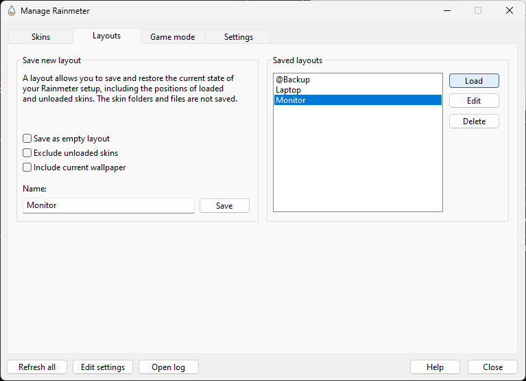

# 🔮 Code Geass Rainmeter Skins

This repository contains custom Rainmeter skins inspired by *Code Geass*. Follow the steps below to set up and use the skins on your own machine.


## 📦 What's Included

| Folder | What it does |
| --- | --- |
| `Skins/GurenHoneycomb` | The Geass logo and the honeycomb app icons. Click the logo to show or hide the icons. |
| `Skins/GurenLauncher` | Full-screen wallpapers that fade in when you hover over an icon. |
| `Skins/@Vault` | Plugins the skins need (`AudioLevelBeta`, `Mouse`). |
| `Layouts/LaptopLayout` | Icon positions for a laptop screen. |
| `Layouts/MonitorLayout` | Icon positions for a larger monitor. |

The layouts load this row of icons under the Geass logo, from left to right:

📁 Folder · ✈️ Telegram · 💻 VS Code · ▶️ YouTube · 💬 Discord · 🌐 Chrome · 🚂 Steam · 🎯 Epic Games · ⚔️ Riot Client · 🎮 Xbox

`GurenHoneycomb` has many more icons (Spotify, Firefox, Valorant, Minecraft, and more). You can load them from Rainmeter's **Skins** tab.

## 📋 Prerequisites

Before using these skins, you must have **Rainmeter** installed on your computer.

### 🔽 Installing Rainmeter

1. Download the latest version of Rainmeter from the official website:  
   [https://www.rainmeter.net/](https://www.rainmeter.net/)
   
2. Follow the installation instructions provided on the website to install Rainmeter.

## 🚀 Setup Instructions

### 1️⃣ Copy the Skins

1. **Download the Repository** 📥  
   Clone or download this repository to your local machine.

2. **Navigate to Your Rainmeter Skins Folder** 📁  
   By default, your Rainmeter skins should be located at:

   ```
   C:\Users\<YourUsername>\Documents\Rainmeter\Skins
   ```

   If your Documents folder is synced with OneDrive, look in `C:\Users\<YourUsername>\OneDrive\Documents\Rainmeter\Skins` instead.

3. **Copy the Skins In** 🔄  
   Copy the `@Vault`, `GurenHoneycomb` and `GurenLauncher` folders from this repository's `Skins` folder into your `Skins` folder. If Windows asks about `@Vault`, choose to merge it.

### 2️⃣ Copy the Layouts

1. **Navigate to the Layouts Folder** 📁  
   Open the following directory (you can paste it into File Explorer's address bar):

   ```
   %APPDATA%\Rainmeter\Layouts
   ```

2. **Copy the Layouts In** 🔄  
   Copy the `LaptopLayout` and `MonitorLayout` folders from this repository's `Layouts` folder into it.

### 3️⃣ Load the Skins in Rainmeter

1. **Open Rainmeter** 🖥️  
Launch Rainmeter from the Start Menu.

2. **Unload the Default Skins** 🗑️  
Unload or delete the default `illustro` skins.

3. **Load a Layout** ✨  

Open the `Layouts` tab, select `LaptopLayout` or `MonitorLayout` (depending on your screen size) and click `Load`.

### 4️⃣ Point the Icons at Your Apps

Each icon opens an app from a path on my PC, so most of them won't work on yours until you change the path.

1. Right-click an icon and choose **Edit skin**.
2. Change the path in the `LeftMouseUpAction` line to your app's `.exe` or shortcut (`.lnk`). Keep the quotes and the `[!HideFadeGroup "Honey"]` part:

   ```ini
   LeftMouseUpAction=["C:\Path\To\Your\App.exe"][!HideFadeGroup "Honey"]
   ```

3. Save the file, then right-click the icon and choose **Refresh skin**.

> 💡 For Microsoft Store apps such as WhatsApp or Xbox, there is no `.exe` path you can use. Create a desktop shortcut to the app and point `LeftMouseUpAction` at that `.lnk` file instead.

## 🎨 Support

If you'd like to customize your own **Honeycomb** icons, I recommend checking out the following YouTube videos:

- [How to Customize Honeycomb Icons](https://www.youtube.com/watch?v=Z1RAFscuFAE&ab_channel=Mork) by Mork 🎬

### ✨ Creating the Hover Effect

To create a hover effect for your icons, you can follow this tutorial:

- [How to Create Hover Effects](https://www.youtube.com/watch?v=4FyO0uf512U&ab_channel=RacTac) by RacTac 🎬


## ❓ Troubleshooting

- If you don't see the skins or layout after following the steps, make sure that you've copied the folders into the correct directories and refreshed Rainmeter.
- If clicking an icon does nothing, its `LeftMouseUpAction` path doesn't exist on your PC. See step 4 above.
- Check if Rainmeter is up-to-date; older versions may not support certain features.

---
